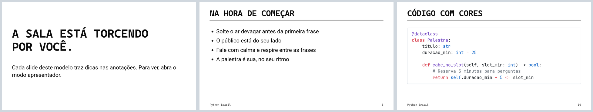
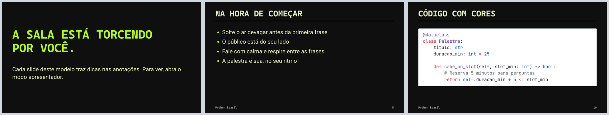
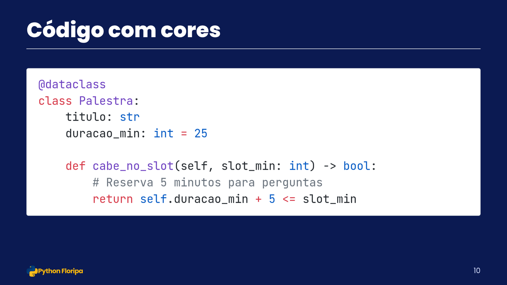
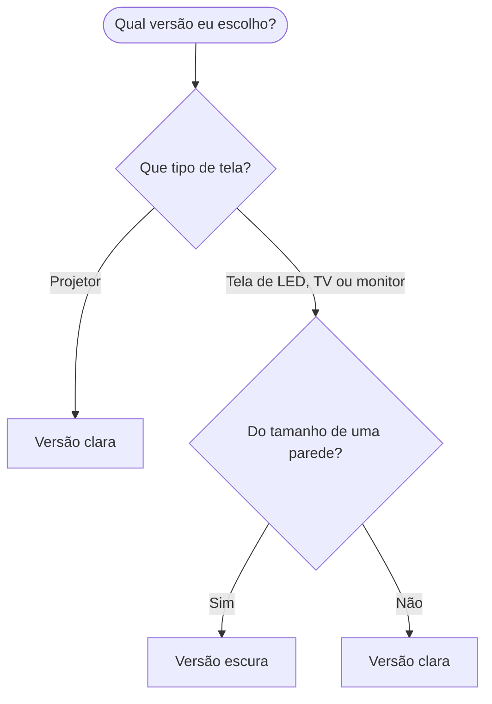

# Modelo de slides para palestras de Python

Em vez de Lorem Ipsum, os slides de exemplo trazem dicas práticas para quem vai apresentar pela primeira ou pela milésima vez: como começar com calma, quanto texto cabe num slide, como deixar o código legível do fundo da sala e o que testar antes de subir no palco. Cada slide mostra um layout, e as anotações trazem mais dicas, que você vê no modo apresentador. Troque as dicas pelo seu conteúdo e aproveite o layout.

Os slides são um arquivo Markdown, apresentado no navegador com o [Slidev](https://sli.dev). O código sai colorido sozinho, e fluxogramas e gráficos são escritos como texto, com o [Mermaid](https://mermaid.js.org).

O modelo já vem com duas marcas, Python Floripa e Python Brasil, cada uma com versão clara e escura. Uma linha no topo do `slides.md` escolhe a marca. Durante a palestra, o botão de lua troca a versão.

### Python Floripa, versão clara


### Python Floripa, versão escura


### Python Brasil, versão clara



### Python Brasil, versão escura



Veja os slides de exemplo [no navegador](https://rodbv.github.io/python-slides-template/), ou em PDF nas versões [clara](https://rodbv.github.io/python-slides-template/slides.pdf) e [escura](https://rodbv.github.io/python-slides-template/slides-escura.pdf).

## Começar

Você vai precisar do [Node.js](https://nodejs.org) 22.12 ou mais novo.

1. Clique em **Use this template > Create a new repository**. Deixe o repositório público: o GitHub Pages é grátis para repositórios públicos.
2. No repositório novo, abra **Settings > Pages** e escolha **GitHub Actions** em **Source**.
3. Na aba **Actions**, abra a execução "pages", que falhou porque o Pages ainda estava desligado, e clique em **Re-run all jobs**. A partir daí, cada push na `main` publica os slides e os PDFs.
4. Na página do repositório, clique na engrenagem de **About** e marque **Use your GitHub Pages website**. O link dos seus slides fica no topo do repositório.
5. Clone o repositório e rode, na pasta dele:

```sh
npm install
npm run dev
```

O navegador abre os slides em `http://localhost:3030`. Edite o `slides.md` e salve: o slide muda na hora.

Na sua cópia, os links deste README apontam para o seu site. Os slides ficam em `https://SEU-USUARIO.github.io/NOME-DO-REPOSITORIO/`, e os PDFs em `.../slides.pdf` (versão clara) e `.../slides-escura.pdf`. Sem o Pages, os PDFs também ficam para baixar em cada execução da aba Actions, no artefato **slides-pdf**.

Esse endereço serve para o QR code do encerramento: o público abre os seus slides no celular.

## Marca e versão

As duas primeiras linhas do `slides.md` escolhem a marca e a versão:

```yaml
---
brand: python-floripa   # ou python-brasil
colorSchema: auto       # auto, light (só a clara) ou dark (só a escura)
---
```

Com `auto`, o botão de lua na barra inferior e a tecla **D** trocam entre a versão clara e a escura. O navegador guarda a escolha, e o modo apresentador acompanha a janela dos slides. Assim você escolhe a versão no dia, depois de ver a tela da sala: veja [Tema claro ou escuro?](#tema-claro-ou-escuro).

Com `light` ou `dark`, o Slidev mostra só essa versão e esconde o botão de lua.

## Tema claro ou escuro?

O código fica num cartão claro nas duas versões. Texto escuro sobre fundo claro se lê melhor, em especial em letra pequena, como a do código ([Piepenbrock, Mayr e Buchner, 2014](https://doi.org/10.1177/0018720813515509)). Essa vantagem aparece com a sala escura e com a sala iluminada ([Buchner e Baumgartner, 2007](https://doi.org/10.1080/00140130701306413)). Se preferir código em fundo escuro, troque `github-light` por `monokai` em `setup/shiki.ts` e deixe a fonte bem grande.



Para o resto dos slides:



No projetor, a luz da sala apaga o preto da projeção, e o fundo claro se lê melhor. Numa tela de LED do tamanho de uma parede, o fundo escuro não ofusca o público. O brilho confortável de uma tela acompanha a luz do ambiente, e uma tela muito clara numa sala com pouca luz cansa a vista ([Zhou e outros, 2021](https://doi.org/10.3390/app11094108)). Numa tela menor, como uma TV ou um monitor grande, o brilho não chega a ofuscar, e a versão clara se lê melhor.

## Cores e fontes da Python Floripa

| | Cor | Hex | Uso |
|---|---|---|---|
|  | Azul-marinho | `#0B1A52` | Texto na versão clara, fundo na escura |
|  | Laranja | `#FFB80D` | Destaque e títulos na versão escura; no fundo claro, só com texto ou borda azul-marinho |
|  | Branco | `#FFFFFF` | Fundo na versão clara, texto na escura |
|  | Azul | `#0540AA` | Links na versão clara |
|  | Azul-claro | `#A9BFFF` | Links na versão escura |

| Fonte | Uso |
|---|---|
| [Poppins](https://fonts.google.com/specimen/Poppins) | Títulos e texto |
| [JetBrains Mono](https://fonts.google.com/specimen/JetBrains+Mono) | Código |

## Uma marca nova

1. Copie a pasta `brands/python-floripa` com o nome da sua comunidade, como `brands/python-sul`.
2. No `brand.css` da cópia, troque `python-floripa` pelo nome novo nas duas linhas `html[data-brand=...]`. Troque as cores, as fontes, o texto do rodapé e o logo.
3. Em `styles/index.css`, acrescente `@import '../brands/python-sul/brand.css';` junto aos outros.
4. No topo do `slides.md`, use `brand: python-sul`. Se a fonte da marca não for Poppins nem Roboto, acrescente a fonte em `fonts:`, no mesmo topo.

Confira o contraste de cada par de texto e fundo no [verificador da WebAIM](https://webaim.org/resources/contrastchecker/): pelo menos 4.5:1 para texto e 3:1 para barras, ícones e bordas.

## No VS Code

Abra a pasta do repositório. O VS Code sugere a extensão [Slidev](https://marketplace.visualstudio.com/items?itemName=antfu.slidev): instale. A extensão lista os slides numa barra lateral e mostra, dentro do editor, a prévia do slide em que o cursor está.

Também dá para editar o `slides.md` direto no GitHub, pelo navegador: a Action publica do mesmo jeito.

## Com um agente de IA

O conteúdo é seu: escreva o roteiro da palestra num arquivo, em tópicos, rascunho ou texto corrido. Depois, abra o repositório no seu editor com o agente e peça a forma. Por exemplo:

```
Meu roteiro está em roteiro.md. Monte os slides em slides.md, no lugar dos
exemplos, usando os layouts do modelo: capa, agenda, uma seção para cada
parte e o encerramento. Uma ideia por slide, o código em blocos com realce,
e o que eu vou falar nas anotações. Não invente conteúdo: se faltar alguma
coisa, me pergunte.
```

O [`AGENTS.md`](AGENTS.md) diz ao agente quais layouts existem, como escrever cada um, e as regras de marca e de conteúdo. O `CLAUDE.md` aponta para o mesmo arquivo.

## Apresentar

Abra o endereço do GitHub Pages, ou rode `npm run dev`.

- **F**: tela cheia.
- Setas ou espaço: próximo slide.
- **O**: visão geral de todos os slides.
- Modo apresentador: o botão da barra inferior, ou o endereço `/presenter`. Ele mostra as anotações, o próximo slide e o cronômetro. Deixe o modo apresentador na sua tela e os slides no telão: as duas janelas andam juntas.

Leve também o PDF num pendrive: ele abre em qualquer computador, sem internet.

## Comandos

| Comando | Faz |
|---|---|
| `npm run dev` | Abre os slides no navegador e atualiza a cada mudança |
| `npm run build` | Gera o site em `dist/` |
| `npm run export` | Gera o PDF da versão clara em `slides-export.pdf` |
| `npm run export:escura` | Gera o PDF da versão escura em `slides-escura.pdf` |
| `npx slidev export --format pptx` | Gera um PowerPoint, com cada slide como imagem |
| `uv run scripts/qr.py https://seu-link` | Troca o QR code em `public/qr.png` |

Com `colorSchema: light` ou `dark`, os dois comandos geram a versão escolhida.

Para exportar, o Slidev usa o Chromium. Se o comando pedir, rode `npx playwright install chromium` uma vez.

## Acessibilidade

- O texto do corpo tem 28 px num slide de 980 px de largura. Para quem senta longe ler, evite texto abaixo de 24 px.
- Os pares de texto e fundo das duas marcas passam no nível AA do WCAG 2.1. As barras dos gráficos têm borda, para passar o contraste de 3:1 também no laranja e no verde limão.
- O idioma do documento é português do Brasil (`lang: pt-BR`), para leitores de tela.
- Escreva o texto alternativo de cada imagem no `alt`: ``.

## Achou um problema?

Abra uma [issue no GitHub](https://github.com/rodbv/python-slides-template/issues) contando o que aconteceu e, se puder, com uma captura de tela. Para mudar o modelo, veja o [`CONTRIBUTING.md`](CONTRIBUTING.md).

## Licenças

- Modelo, textos de exemplo e código deste repositório: [CC0 1.0](LICENSE) (domínio público). Use, mude e compartilhe sem pedir permissão nem dar crédito.
- Logo da Python Floripa: da comunidade Python Floripa.
- Logo e identidade visual da Python Brasil 2026: Python Brasil 2026 e APyB, do manual de marca oficial do evento, criado por [Ana Terhorst](https://anaterhorstdesign.com).
- Fontes Poppins, Roboto, Cascadia Mono e JetBrains Mono: SIL Open Font License 1.1, carregadas do Google Fonts.
