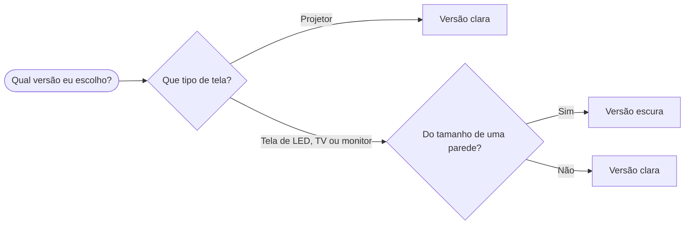
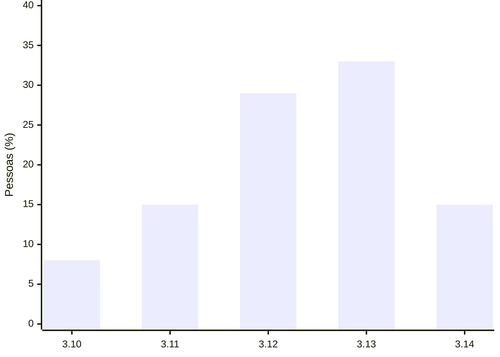

# Título da sua palestra

Subtítulo ou frase de efeito

**Seu nome aqui** · @seu_usuario

<!--
- Que bom que você vai palestrar! O seu jeito de falar vale mais do que qualquer dica deste modelo.
- Este arquivo é um modelo: cada slide de exemplo mostra um layout e traz dicas nestas anotações. Use as que servirem para você.
- No topo deste arquivo, brand escolhe a marca (python-floripa ou python-brasil) e colorSchema escolhe a versão: light (clara) ou dark (escura).
- Ao reaproveitar um slide, apague estas anotações e escreva as suas.
-->

---
layout: statement
---

# A sala está torcendo por você.

Cada slide deste modelo traz dicas nas anotações. Para ver, abra o modo apresentador.

<!--
- Uma ideia por slide, em duas linhas no máximo. Que frase o público deve levar da sala?
- Quase toda pessoa palestrante fica nervosa. Se bater o nervosismo, fale para um rosto amigo na plateia.
- O modo apresentador mostra as anotações, o próximo slide e o cronômetro. Abra pelo botão da barra inferior ou pelo endereço /presenter.
-->

---
layout: two-cols
---


::right::

# Seu nome aqui

### O que você faz · onde

- Quem abre a sessão costuma apresentar você
- Com o tempo curto, este slide pode sair
- Uma autodescrição ajuda quem não vê

<!--
- Para usar a sua foto, troque public/exemplo/foto.png pela sua e escreva a descrição no alt.
- Uma autodescrição ajuda quem não vê, por exemplo: “Sou a Maria, tenho 1,60 m e cabelo preto solto, uso óculos verdes e estou com uma camiseta da PyLadies.”
-->

---
layout: quote
---

# Legibilidade conta.

The Zen of Python, PEP 20

Dicas, <mark>não regras</mark>: use as que servirem para você.

<!--
- Até três linhas, com quem disse e onde. Vale conferir a autoria numa fonte primária.
- As aspas vêm do tema: escreva a citação sem aspas.
- O marca-texto é a tag <mark>: texto escuro sobre a cor de destaque, legível na versão clara e na escura.
-->

---

# Na hora de começar

- Solte o ar devagar antes da primeira frase
- O público está do seu lado
- Fale com calma e respire entre as frases
- A palestra é sua, no seu ritmo

<!--
- De três a cinco tópicos por slide. Se o texto não couber, divida o conteúdo em dois slides.
-->

---

# Agenda

1. A agenda mostra o caminho da palestra
2. Três a cinco partes costumam bastar
3. Volte a este slide entre uma parte e outra
4. Cada parte pode abrir com um slide de seção
5. Opcional: pode sair se o tempo for curto

<!--
- A numeração é automática.
- Voltar à agenda entre as partes ajuda o público a saber onde está.
- Conte mais ou menos 1 minuto por slide, depois de separar uns 5 minutos para perguntas.
-->

---
layout: section
---

<div class="numero">01</div>

# Uma seção para cada parte da agenda

<!--
- O número acompanha a ordem da agenda.
-->

---
layout: two-cols-header
---

# Texto no slide

::left::

### Em vez de

- Parágrafos inteiros
- Ler o slide em voz alta
- Diminuir a fonte para caber
- A “colinha” no slide

::right::

### Experimente

- Uma ideia por slide
- Falar o que o slide não diz
- Dividir em dois slides
- A “colinha” nas anotações do slide

<!--
- O layout two-cols-header põe o título nas duas colunas, e cada coluna tem o seu subtítulo: antes e depois, problema e solução.
- O detalhe e a “colinha” vão para as anotações, que só você vê.
-->

---
layout: two-cols
---

# Imagens que explicam

- Um diagrama no lugar de um parágrafo
- Uma imagem por ideia
- Descreva para quem não vê

::right::


<!--
- A caixa cinza marca o lugar da sua imagem: troque public/exemplo/imagem.png pela sua e escreva o texto alternativo no alt.
- Na fala, diga o que a imagem mostra, para quem não enxerga e para quem ouve a gravação.
- Confira se a licença da imagem permite o uso numa palestra gravada e dê o crédito no slide.
-->

---

# Código com cores

```python
@dataclass
class Palestra:
    titulo: str
    duracao_min: int = 25

    def cabe_no_slot(self, slot_min: int) -> bool:
        # Reserva 5 minutos para perguntas
        return self.duracao_min + 5 <= slot_min
```

<!--
- Se a sua palestra não tem código, pode pular este slide.
- Até 8 linhas e 60 colunas. Se o trecho for maior, divida em slides ou mostre só o que importa.
- O Slidev colore o código sozinho: abra o bloco com ```python, ou com a linguagem do trecho.
- O código fica num cartão claro também na versão escura. Estudos de legibilidade mostram que texto escuro sobre fundo claro se lê melhor, em especial em letra pequena, como a do código (Piepenbrock, Mayr e Buchner, 2014).
- Se preferir código em fundo escuro, troque github-light por monokai em setup/shiki.ts e deixe a fonte bem grande.
-->

---
layout: two-cols-header
---

# Um exemplo menor também ensina

::left::

### Muito pequeno para ler 😟

<div class="miuda">

```python
from dataclasses import dataclass
from datetime import datetime, timedelta


@dataclass
class Palestra:
    titulo: str
    inicio: datetime
    duracao_min: int = 25

    @property
    def fim(self) -> datetime:
        return self.inicio + timedelta(minutes=self.duracao_min)

    def conflita_com(self, outra: "Palestra") -> bool:
        return self.inicio < outra.fim and outra.inicio < self.fim
```

</div>

::right::

### Dá para ler do fundo 😊

```python
def cabe(duracao, slot):
    # + 5 min de perguntas
    total = duracao + 5
    return total <= slot
```

<!--
- Antes e depois de uma refatoração, ou duas formas de resolver o mesmo problema.
- Cada bloco aceita até 26 colunas. O bloco da esquerda fica pequeno de propósito, para mostrar como a letra miúda aparece no telão.
- Emoji também é recurso: um rosto triste ou feliz diz na hora qual lado é o exemplo a evitar. O título diz o mesmo em palavras, para quem não vê o emoji.
-->

---

# Três números que ajudam

<div class="numeros">
  <div><strong>18</strong><span>pontos de letra: dá para ler do fundo da sala</span></div>
  <div><strong>1</strong><span>ensaio em voz alta mostra quanto a palestra dura</span></div>
  <div><strong>5</strong><span>minutos para perguntas no fim</span></div>
</div>

<!--
- Até três números, cada um com um rótulo do que mede.
- Ensaiar em voz alta mostra quanto a palestra dura e costuma deixar a fala mais solta.
-->

---

# O seu dia de palestra

| Quando | Sugestão |
|---|---|
| Antes do evento | Tirar dúvidas com a organização |
| Na véspera | Pega leve no karaokê :P Voz e descanso em dia |
| No dia | Chegar cedo e conhecer a sala |
| 15 min antes | Testar o adaptador de vídeo e o microfone |
| Na palestra | Microfone perto da boca, mesmo ao olhar para a tela |
| Depois | Publicar os slides no link do QR code |

<!--
- Tabelas em Markdown já saem com o cabeçalho na cor de destaque.
- Testar em casa o adaptador de vídeo e o espelhamento de tela costuma deixar o dia mais tranquilo.
-->

---

# Qual versão eu escolho?



<!--
- Este é um fluxograma em Mermaid: escreva o diagrama como texto, num bloco ```mermaid, e o Slidev desenha. O losango marca uma decisão.
- Para trocar de versão, mude colorSchema no topo deste arquivo: light (clara) ou dark (escura). O código fica em fundo claro nas duas.
- No projetor, a luz da sala apaga o preto da projeção. Numa tela do tamanho de uma parede, o fundo escuro não ofusca o público.
-->

---

# Versão do Python que você usa (%)



<p class="muted">Dados de exemplo</p>

<!--
- O gráfico também é Mermaid: troque os rótulos em x-axis e os valores em bar.
- Diga em voz alta o que o público deve ver nas barras, para quem não vê o gráfico.
- Um gráfico, uma mensagem.
-->

---
layout: two-cols
layoutClass: destaque
---

# Sua palestra é para todo mundo

::right::

- Conteúdo para todas as idades
- Humor que não ridiculariza ninguém, exemplos sem estereótipos
- Na dúvida sobre algum conteúdo, a organização ajuda

<!--
- O código de conduta do evento vale para todas as pessoas, inclusive no palco.
- O painel colorido guarda a mensagem que a sala não pode perder.
-->

---

# Referências

- Código de conduta da Python Brasil [python.org.br/cdc](https://python.org.br/cdc)
- Slidev, slides em Markdown [sli.dev](https://sli.dev)
- Diagramas em texto [mermaid.js.org](https://mermaid.js.org)
- Verificador de contraste [webaim.org/resources/contrastchecker](https://webaim.org/resources/contrastchecker/)

<!--
- Um material por linha, com o nome e o endereço curto.
- Uma página só com todos os links (um README, um gist ou um Linktree) cabe num QR code no encerramento.
-->

---
layout: two-cols
---

# Perguntas?

**Seu nome aqui**

@seu_usuario

voce@exemplo.com.br

::right::

<div class="flex flex-col items-center justify-center h-full">
  
  <p class="qr-legenda">Troque pelo seu QR code:<br>contato, slides ou site</p>
</div>

<!--
- O QR code pode levar ao seu contato, aos seus slides ou a uma página com tudo isso. Com uma página só, você troca os links depois sem mudar o QR code.
- Para gerar o seu: uv run scripts/qr.py https://seu-link. O script troca public/qr.png.
- Nas perguntas, repita cada pergunta no microfone, para a sala e a gravação.
- “Não sei, posso ver e te respondo depois” é uma boa resposta.
-->
